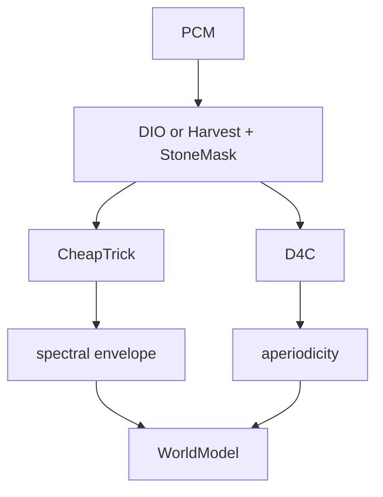
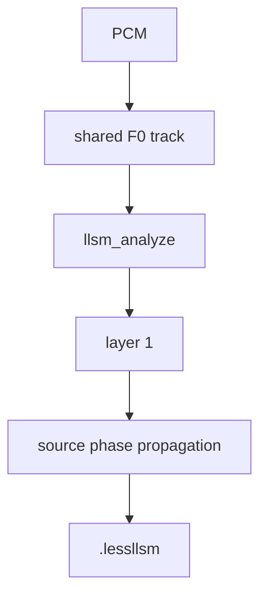

The F0 front end and the selected backend turn the source into the note-independent analysis.

## F0 estimation

DIO or Harvest produces the candidate F0 track. DIO is followed by StoneMask; Harvest is not refined again. The shared track is used by WORLD, LLSM, neural polish and feature assembly. LLSM disables libllsm2's own refinement with `f0_refine = 0`.

The analysis frame count is

$$
N_f=\left\lfloor\frac{1000N_x}{f_sT_0}\right\rfloor+1,
\qquad
T_0=\frac{1000\cdot 256}{44100}\approx 5.8054\ \text{ms}
$$

by default. Defaults: Harvest mode, 40 Hz floor, 0.1 allowed range for DIO, and a 71 Hz CheapTrick floor. A frame with $f_0=0$ is unvoiced.

## WORLD modeling

CheapTrick estimates a spectral envelope $P_s(\omega)$ from the F0 track; D4C estimates an aperiodicity $A(\omega)\in[0,1]$.

D4C processes frames in a fixed eight-block partition. The random-safeguard sequence is independent of the worker count, so the analysis is reproducible; `max_workers` changes concurrency only. The result is `WorldModel`: F0, spectrogram, aperiodicity, sample rate, frame period, FFT size and `w_length`.

## LLSM modeling

LLSM models each frame as harmonics plus noise:

$$
x(t)=\sum_{k=1}^{K(t)}A_k(t)\cos\left(k\omega_0(t)t+\phi_k(t)\right)+n(t).
$$

The analysis uses the shared F0 track with `thop = T_0/1000`, `npsd = 128`, `maxnhar = 400`, `maxnhar_e = 5`, `hm_method = HMPP` and `f0_refine = 0`. The result is converted to layer 1 (`llsm_chunk_tolayer1`, FFT 2048) and phase-propagated before caching.

## Neural modeling

The neural backend reuses `.lessaudio` and `WorldTransform`. `Synthesize` renders the transformed WORLD model once, then extracts NHVSing-compatible mel/F0 from that waveform; it writes no cache of its own.

Next: [Pitch and time](transform.md).
