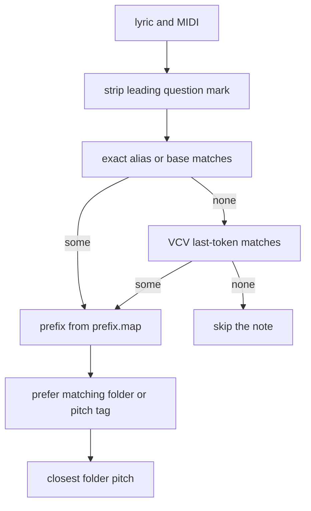

This stage turns the host argv and the UST/oto fields into `RenderParams`: velocity, fixed and stretched lengths, placement, pitchbend and the effective configuration.

`Application` dispatches on the first argument:

| Invocation | Behavior |
| --- | --- |
| `--help`, `--version` | print usage or version |
| none | logo and usage |
| `<directory>` | analyze every WAV in the directory |
| `--polish <in> <out>` | whole-song neural resynthesis |
| `--feature-plan <plan.toml>` | feature-level neural assembly |
| `--f0 <in> <out.csv>` | export the configured F0 track |
| at least four paths | UTAU resampler mode |

In UTAU resampler mode the argv positions are:

| Position | Field | Meaning |
| --- | --- | --- |
| 1 | input WAV | voicebank sample |
| 2 | output WAV | rendered note |
| 3 | note | note name such as `A4` or `A#3` |
| 4 | time percent | mapped to velocity |
| 5 | flags | UTAU flags; `C`/`Y`/`G` tokens select voice color, other flags are retained but unused |
| 6 | offset | source offset in ms |
| 7 | required | requested output length in ms |
| 8 | fixed | consonant/fixed part in ms |
| 9 | last unused | tail to leave unused; negative counts from the end |
| 10 | volume | percent, divided by 100 |
| 11 | modulation | integer percent |
| 12 | tempo | optional leading `!`, default 120 |
| 13 | pitchbend | UTAU 64-character pitch encoding |

argv[0] is the program name and is kept as `local_name`. The parser rejects fewer than four arguments and invalid numbers.

## Velocity and lengths

The protocol calls argv[4] the time percentage; the parser names it `time_percent` and turns it into a velocity factor:

$$
v=2^{p/100-1}.
$$

The Python host passes the UST `Velocity` value here, so the default 100 gives $v=1$. `libUTAU::CheckPara` then converts the raw lengths into the time map. With sample count $N_x$, sample rate $f_s$, wave length $L_w$, offset $o$, fixed part $F$, last unused $L_u$ and required length $R$:

$$
L_w=\frac{1000N_x}{f_s},
\qquad
L_u\leftarrow\max\left(0,L_w-o+L_u\right)
$$

for a negative last-unused value. The pre-cross section, base length and cross length are

$$
L_p=L_w-o-F-L_u,
\qquad
L_b=\frac{F}{v},
\qquad
L_c=R-L_b.
$$

If $L_c>0$, the stretch factor is

$$
\sigma=\operatorname{clamp}\left(\frac{L_p}{L_c},0,1\right).
$$

The output sample count is

$$
N_o=\left\lfloor R\cdot 10^{-3}f_s+1\right\rfloor.
$$

The parser throws when the offset and last-unused section exceed the sample, when the pre-cross section is empty while a stretch is requested, or when a positive cross section would be negative because the required length is shorter than the fixed part.

## UST fields

| Field | Use |
| --- | --- |
| `Tempo` | BPM; default 120 |
| `Length` | note length in ticks; 480 ticks per quarter |
| `Lyric` | `R` is a rest; `x`, `息`, `吸`, `吐`, `・`, `breath`, and `R息`/`R吐` alias lyrics are breath markers handled by the host |
| `NoteNum` | MIDI note number |
| `Velocity` | 0-200, default 100; passed as argv[4] |
| `PreUtterance` | absolute preutterance override in ms |
| `VoiceOverlap` | absolute overlap override in ms |
| `Intensity` | volume percent, default 100; passed as argv[10] |
| `Modulation` / `Moduration` | modulation percent, default 0 |
| `Flags` | per-note flags; falls back to `#SETTING` flags. `Cnn`/`Ynn`/`Gnn` set clear/cry/growl, and `>` separates start and end weights |
| `Envelope` | UST envelope string; default `0,5,35,0,100,100,0,%,0,10,100` |
| `PBS` / `PBW` / `PBY` | pitch start, widths and values; also suppresses automatic vibrato and portamento |

`scripts/render_ust.py` adds automatic vibrato to plain long notes, automatic portamento to adjacent notes, and automatic breath into phrase gaps. It only fills gaps: explicit `VBR`, pitch curves, and breath notes take precedence. See [Expression and voice color](../guides/expression.md).

## oto.ini and prefix.map

An oto entry is

```text
sample.wav=alias,offset,consonant,cutoff,preutterance,overlap
```

All numeric fields are milliseconds. A negative cutoff is measured from the end of the sample. `prefix.map` maps a note name to a folder prefix, for example `A3<TAB><TAB>A3低`; the host prefers entries in that folder or whose alias carries the matching pitch tag.



A leading `?` disables `prefix.map` for that note. When two candidates survive, the closest pitch folder to the note wins; entries without a pitch tag are considered last.

## From UST to argv

The host scales the oto values by

$$
r=2^{1-V/100},
\qquad
P=rP_{\text{oto}},
\qquad
O=rO_{\text{oto}}.
$$

Adjacent notes are capped by ACPT rules: the preutterance is limited by the previous note's duration, by the previous note's own short preutterance, or by the gap when the gap is smaller than the preutterance. `PreUtterance` and `VoiceOverlap` then override the automatic values. The used length and absolute start are

$$
L_{\text{used}}=\max\left(0,D+P-\max\left(P_{\text{next}},P_{\text{next}}-O_{\text{next}}\right)+\max\left(O_{\text{next}},0\right)\right),
\qquad
S=T-P.
$$

The resampler arguments are shifted so that the requested preutterance lands at the right sample:

$$
\text{pulled}=\operatorname{clamp}\left(\operatorname{round}\left(\frac{P}{r}-P_{\text{oto}},3\right),0,\max\left(0,o_{\text{oto}}\right)\right),
$$

$$
\text{offset}_{\text{arg}}=o_{\text{oto}}-\text{pulled},
\qquad
\text{fixed}_{\text{arg}}=C_{\text{oto}}+\text{pulled}.
$$

A negative cutoff is pulled the same way; a positive cutoff is passed through. The buffer head is

$$
\text{pitchLead}=\left(P_{\text{oto}}+\text{pulled}\right)r,
\qquad
\text{skip}=\max\left(0,\text{pitchLead}-P\right).
$$

The required length is rounded up to the 50 ms grid:

$$
\text{required}=50\left(\left\lfloor\frac{\max\left(L_{\text{used}}+\text{skip},\text{fixed}_{\text{arg}}r\right)}{50}+\frac12\right\rfloor+1\right).
$$

## Configuration

`lessampler.less` is TOML:

| Section | Fields |
| --- | --- |
| `[config]` | `version`, `debug` |
| `[audio_model]` | `backend`, `frame_period`, `fft_size`, `model_amp` |
| `[f0]` | `estimator`, `f0_speed`, `f0_dio_floor`, `f0_harvest_floor`, `f0_ceil`, `f0_cheap_trick_floor`, `f0_allow_range`, `neural_model_path`, `neural_threads`, `neural_threshold`, `neural_floor`, `neural_ceil` |
| `[ap]` | `ap_threshold` |
| `[preprocess]` | `enabled`, `highpass_hz`, `declick`, `declick_threshold`, `denoise`, `denoise_db` |
| `[neural]` | `preset`, `model_path`, `threads`, `target_rms`, and the vocoder contract fields |
| `[master]` | `preset` |
| `[style]` | `default`, `amount`, `morph_ms` |

`ConfigResolver` loads the global file and merges `<voicebank>/lessvoice.less`; the resolved config is cached per voicebank directory. `audio_model.backend` is `world`, `llsm` or `neural`; selecting a backend that was not compiled in throws. `[f0] estimator` is `auto`, `harvest`, `dio`, `llsm`, or `neural`; `auto` follows the backend and falls back to Harvest when the optional estimator is unavailable. `f0_mode` remains a deprecated alias.

The output of this stage is `RenderParams` plus the effective `Config`.

Next: [Source and cache](source.md).
