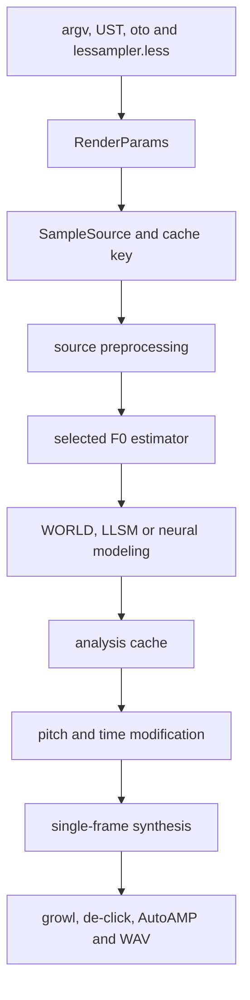

This page follows one note through the engine in execution order: arguments first, then the source and cache, then F0 and modeling, then pitch and time modification, then single-frame synthesis, then output. The backend boundary is `VocoderBackend::Prepare` for the cacheable analysis and `VocoderBackend::Synthesize` for the per-note render. The engine and hosts never inspect backend data.

## Steps

| Step | Page |
| --- | --- |
| 1 | [Arguments in](arguments.md) |
| 2 | [Source and cache](source.md) |
| 2.5 | [Source preprocessing](preprocess.md) |
| 3 | [Modeling](modeling.md) |
| F0 | [F0 estimation](f0.md) |
| 4 | [Pitch and time](transform.md) |
| 5 | [Single-frame synthesis](synthesis.md) |
| 6 | [Output](output.md) |
