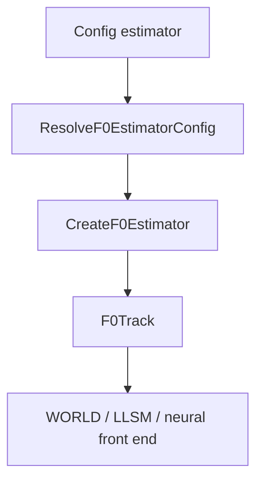
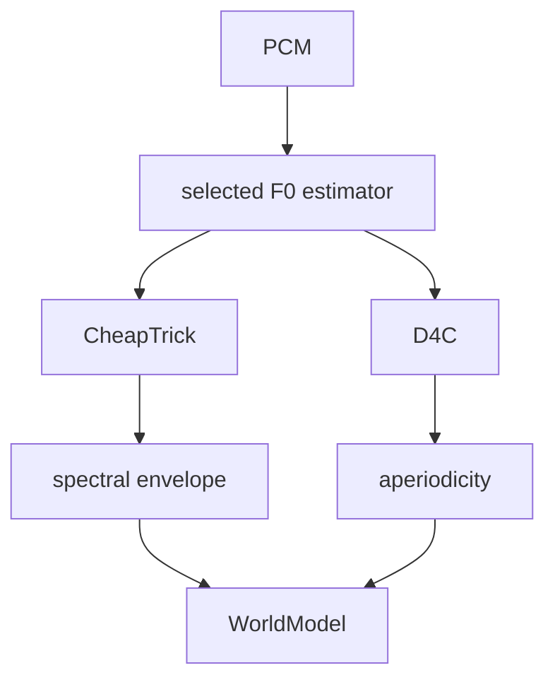
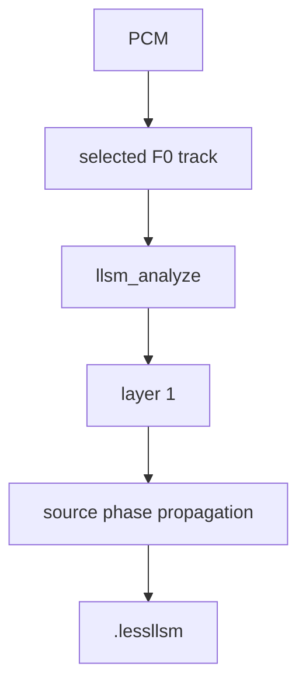

The selected F0 estimator and backend turn the source into the note-independent analysis.

## F0 estimation

F0 is a selectable estimator behind `CreateF0Estimator`:

| Estimator | Backend | Track |
| --- | --- | --- |
| `harvest` | WORLD | Harvest |
| `dio` | WORLD | DIO + StoneMask |
| `llsm` | LLSM | Harvest initial + `llsm_refine_f0` |
| `neural` | ONNX | RMVPE salience or direct `f0` + `uv`, 10 ms frames, resampled to the model frame period |

`estimator = "auto"` follows `[audio_model] backend`; unavailable optional estimators fall back to Harvest with a warning, while an explicit unavailable estimator throws. The resolved kind is part of the analysis fingerprint, so the selected track is never mixed with a cache from another estimator.

LLSM still sets `f0_refine = 0`: when `estimator = "llsm"`, `LlsmF0Estimator` has already called `llsm_refine_f0`; when another estimator is selected, its track is final. Neural polish and feature assembly create one estimator per operation and pass the selected track to the mel front end.

The analysis frame count is

$$
N_f=\left\lfloor\frac{1000N_x}{f_sT_0}\right\rfloor+1,
\qquad
T_0=\frac{1000\cdot 256}{44100}\approx 5.8050\ \text{ms}
$$

by default. Defaults: auto (Harvest for WORLD), 40 Hz floor, 0.1 allowed range for DIO, a 71 Hz CheapTrick floor, and a 1200 Hz RMVPE ceiling. A frame with $f_0=0$ is unvoiced.

## WORLD modeling

CheapTrick estimates a spectral envelope $P_s(\omega)$ from the F0 track; D4C estimates an aperiodicity $A(\omega)\in[0,1]$.

D4C processes frames in a fixed eight-block partition. The random-safeguard sequence is independent of the worker count, so the analysis is reproducible; `max_workers` changes concurrency only. The result is `WorldModel`: F0, spectrogram, aperiodicity, sample rate, frame period, FFT size and `w_length`.

## LLSM modeling

LLSM models each frame as harmonics plus noise:

$$
x(t)=\sum_{k=1}^{K(t)}A_k(t)\cos\left(k\omega_0(t)t+\phi_k(t)\right)+n(t).
$$

The analysis uses the selected F0 track with `thop = T_0/1000`, `npsd = 128`, `maxnhar = 400`, `maxnhar_e = 5`, `hm_method = HMPP` and `f0_refine = 0`. When `estimator = "llsm"`, the track already contains `llsm_refine_f0` output. The result is converted to layer 1 (`llsm_chunk_tolayer1`, FFT 2048) and phase-propagated before caching.

## Neural modeling

The neural backend reuses `.lessaudio` and `WorldTransform`. `Synthesize` renders the transformed WORLD model once, then extracts NHVSing-compatible mel/F0 from that waveform; it writes no cache of its own.

Next: [Pitch and time](transform.md).
