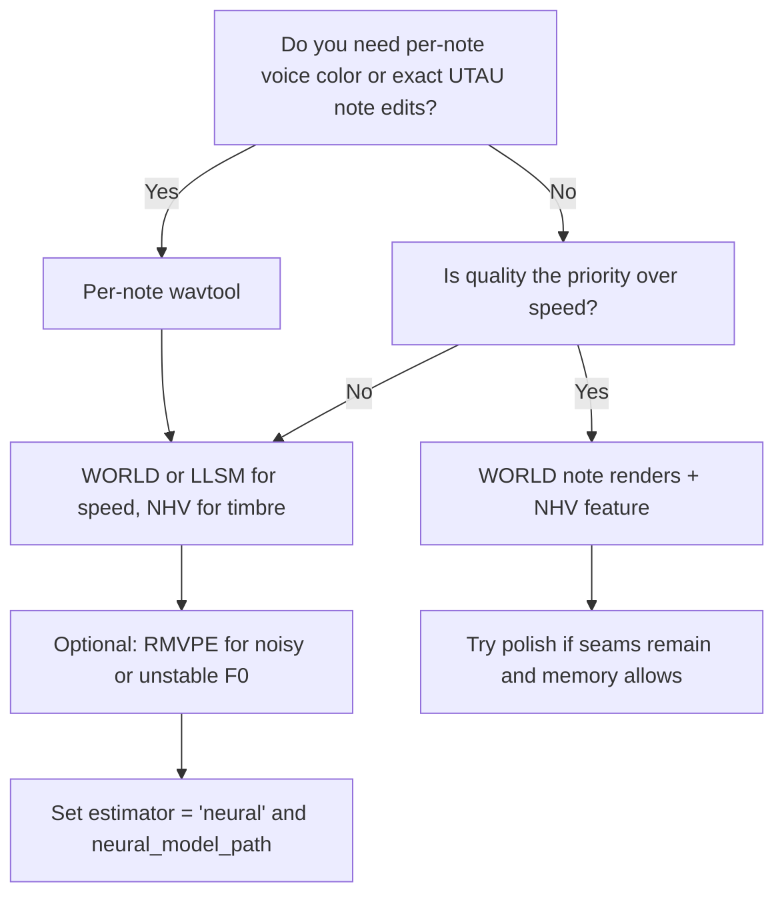

The configuration has four independent axes. They multiply, but most combinations are not useful. Pick one value from each axis, then use the [configurator](../getting-started/configurator.md) to write the file.

| Axis | Values | What it changes |
| --- | --- | --- |
| Backend | `world`, `llsm`, `neural` | The note renderer and its analysis cache |
| Assembly | per-note wavtool, `--feature`, `--polish` | Where notes are joined and how many vocoder passes run |
| F0 estimator | `auto`, `harvest`, `dio`, `llsm`, `neural` | The pitch track used by analysis and synthesis |
| Voice color | `natural`, `clear`, `cry`, `growl` | Synthesis-only spectral shaping and growl |

`backend` is a configuration value. `--feature` and `--polish` are assembly commands; the configured backend still renders the note WAVs. The assembly mode is not stored in `lessampler.less`.

## Start with the default

Use `world-edit` for ordinary UTAU tuning. It is the fastest path, the analysis is deterministic, and every per-note control survives assembly.

Use `nhv-note` when the neural timbre is worth the extra process time. It keeps the UTAU time/pitch map and the note WAVs, so envelopes, overlaps, pitch bends and voice color behave the same as in WORLD. In the project benchmark it is the best per-note neural path; PC-NSF is close and worth A/B testing on the target voicebank.

Use `llsm-edit` for a more harmonic, less buzzy note render than WORLD while staying entirely in the analysis/synthesis domain.

## Per-note or whole-song

| Mode | Command | Keeps per-note controls | Vocoder passes | Notes |
| --- | --- | --- | --- | --- |
| Wavtool | default | Yes | One per note | Works with WORLD, LLSM or neural notes; voice color is intact |
| Feature | `--feature` | Envelopes and timing, weaker color | One global | WORLD/LLSM note renders only; the vocoder sees one timeline |
| Polish | `--polish` | Mix timing, weaker color | One global | Resynthesizes the finished mix; highest memory use |

Feature assembly slices each note WAV, extracts mel/F0, applies the UST envelope in feature space, and runs the vocoder once over the assembled timeline. It avoids the per-note phase resets that make wavtool output sound segmented. Polish does the same on the final mix, so it also removes any assembly seams, but it regenerates the timbre more aggressively.

Both modes re-estimate F0 and mel from the note WAVs. A clear/cry/growl color baked into a note can be weakened. The wavtool path is the only one that preserves the full color.

## Decision tree

## Benchmark summary

SingMOS-Pro scores from the 45 s reference excerpt, 10 s chunks:

| Path | Score |
| --- | --- |
| WORLD per note | 3.145 |
| LLSM per note | 3.315 |
| NHVSing per note | 3.403 |
| PC-NSF per note | 3.350 |
| WORLD notes + NHV feature | 3.811 |
| LLSM notes + NHV feature | 3.625 |
| WORLD mix + NHV polish | 3.829 |
| WORLD mix + PC-NSF polish | 3.719 |

NHVSing with the default `world` frontend is the strongest per-note result. The source-mel, source-wave and world-spectral frontends scored 2.22–3.13 and are documented as experiments, not options to use. Treat differences under about 0.1 as noise and A/B on the actual voicebank.

## F0 choice

`auto` is the default. It follows the backend: Harvest for WORLD, Harvest plus `llsm_refine_f0` for LLSM, and RMVPE for neural when the model is available. It falls back to Harvest with a warning if the optional estimator is missing.

Set `estimator = "dio"` only when first-pass analysis speed matters more than pitch stability. Set `estimator = "neural"` (RMVPE) when the voicebank has noisy, breathy or unstable samples that confuse Harvest; it needs a separate model. Keep an explicit estimator if you switch between WORLD and neural and want both to share one analysis cache.

## Scenario IDs

| Goal | Scenario |
| --- | --- |
| Fastest, most predictable | `world-baseline`, `world-edit` |
| Harmonic note render | `llsm-edit` |
| Best per-note quality | `nhv-note` |
| Alternative neural timbre | `pcnsf-note` |
| Better F0 on difficult samples | `llsm-rmvpe`, `nhv-note-rmvpe`, `pcnsf-note-rmvpe` |
| Highest offline quality | `nhv-feature`, `llsm-feature`, `pcnsf-feature`, `nhv-polish`, `pcnsf-polish` |
| Experiment only | `nhv-source-mel`, `pcnsf-source-mel` |

The full list and generated TOML are in [Configuration configurator](../getting-started/configurator.md). Model downloads and build setup are in [DNN deployment](../guides/neural-deployment.md).

## Combinations to avoid

- Neural note renders plus `--feature` or `--polish` run the vocoder twice. Use WORLD or LLSM for the note pass.
- `--feature` and `--polish` together are rejected by the host.
- `estimator = "llsm"` needs an LLSM build; selecting it without one throws instead of silently changing the pitch track.
- The experimental source frontends are kept for benchmarking, not for production.
