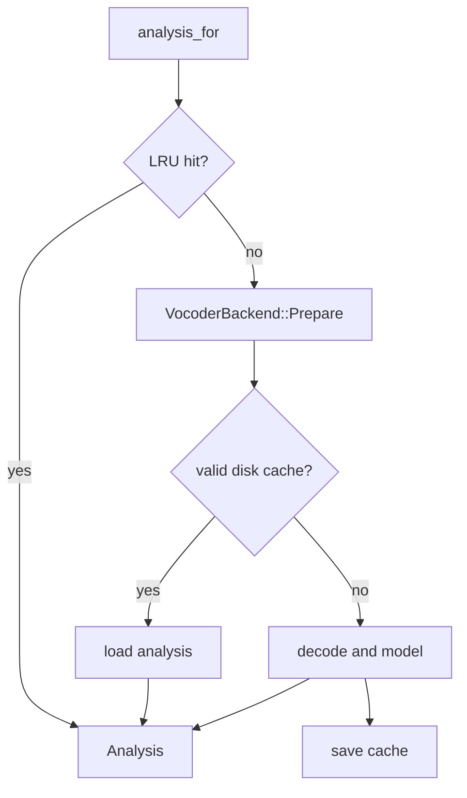

After the parameters, the engine resolves the source and decides whether the note-independent analysis can be reused.

`SampleSource` probes the WAV header and keeps the PCM lazy. `RenderEngine::analysis_for` looks up an in-memory LRU keyed by the backend kind and version, the effective config fingerprint, the canonical source path, and the source size and mtime.

| File | Owner | Reused by |
| --- | --- | --- |
| `.lessaudio` | `Vocoder/World/WorldModelCache` | WORLD, neural |
| `.lessllsm` | `Vocoder/Llsm/LlsmCache` | LLSM |

Both sidecars store the config fingerprint and source size and mtime. The backend is not part of the fingerprint, so switching between WORLD, LLSM and neural keeps the WORLD analysis. A stale or corrupt cache is discarded and rebuilt; cache writes are best-effort.

## Cache fingerprint

The cache key is the 64-bit FNV-1a hash of the analysis-affecting settings:

$$
h_0=1469598103934665603,
\qquad
h_{i+1}=\left(h_i\oplus c_i\right)\cdot 1099511628211\pmod{2^{64}}.
$$

The hash is formatted as 16 hex digits. The fields are `frame_period`, `fft_size`, `model_amp`, `f0_speed`, the three F0 floors, `f0_allow_range`, `ap_threshold` and `f0_mode`; the backend is excluded.

Next: [Modeling](modeling.md).
