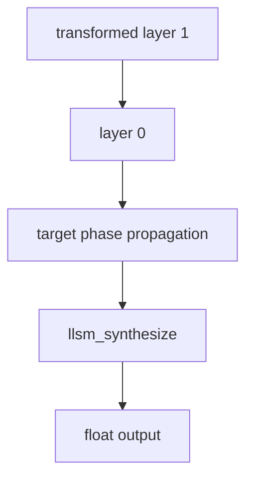

The transformed model is rendered into a waveform, one frame parameter at a time, then the frames are combined by the backend synthesizer.

## WORLD

WORLD synthesis splits the envelope into a periodic and a noise component:

$$
H(\omega)=\sqrt{P_s(\omega)\left(1-A(\omega)\right)},
\qquad
N(\omega)=\sqrt{P_s(\omega)A(\omega)}.
$$

$$
y[n]=\sum_{\omega}H(\omega)\cos\left(\omega n+\phi_\omega\right)+\text{noise}[n].
$$

Each frame contributes its harmonic and noise terms; `WorldSynthesizer` drives WORLD's realtime synthesizer with a 64-sample buffer and overlap-adds the frames into the output vector. WORLD renders the interval of frame `k-1` when frame `k` is added, so the driver adds the final frame once more and drains it; otherwise every note ends with a 0-7 ms exact-zero tail. A 1.5 ms raised-cosine fade is applied to both note edges before the per-note gain stage.

## LLSM

Synthesis interpolates layer-1 F0, RD, harmonic phase, harmonic magnitude and noise PSD along the time map, writes the target F0, converts back to layer 0, propagates the target phase, and calls `llsm_synthesize`. The C library is seeded with `srand(1)` for reproducible noise excitation; samples are `float`.

## Neural

The per-note neural path extracts 128-bin log-mel from the preliminary WORLD waveform, builds continuous F0 and an unvoiced flag from the transformed analysis (which carries the selected F0 estimator's track), then runs the ONNX graph. Whole-song polish and feature assembly are separate modes and are described in [Neural backends](../guides/neural.md).

Next: [Output](output.md).
