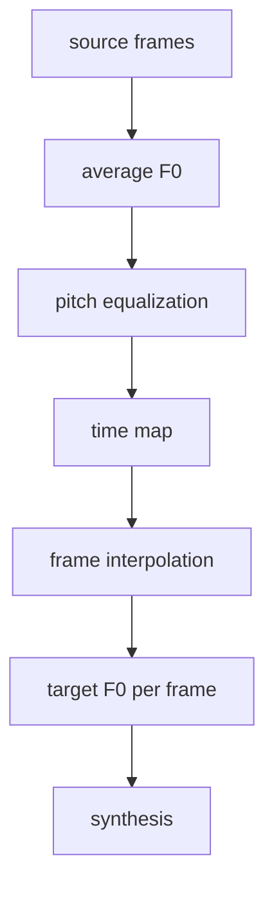

The analysis is re-targeted to the note pitch and the UTAU time map. WORLD, LLSM, and the per-note neural path use this transform.

The average F0 uses a confidence weight over the previous six frames:

$$
\bar f=\frac{\sum_i f_iw_i}{\sum_iw_i},
\qquad
w_i=\prod_{j=0}^{5}\frac{f_i}{f_i+\left(f_{i-j-1}-f_i\right)^2}
$$

for $55<f_i<1200$; frames outside that range are skipped. Boundary terms use $1/(1+f_i)$.

Pitch modulation and key change are applied as

$$
\tilde f_i=\left(\left(f_i-\bar f\right)\frac{m}{100}+\bar f\right)\frac{s}{\bar f},
$$

where $m$ is the modulation percentage and $s=f_{\text{midi}}(n)$ is the target note frequency.

The time map uses the parser values $v=2^{p/100-1}$, offset $o$, fixed part $F$ and stretch $\sigma$:

$$
t_{\text{in}}=
\begin{cases}
o+v\,t_{\text{out}}, & t_{\text{out}}<b,\\
o+F+\sigma\left(t_{\text{out}}-b\right), & t_{\text{out}}\ge b,
\end{cases}
\qquad
b=\frac{F}{v}.
$$

Frames are read at $t_{\text{in}}/T_0$; F0, the spectrogram, and aperiodicity are linearly interpolated. The transform requests

$$
N_{\text{out}}=\left\lfloor\frac{1000N_{\text{out,samples}}}{f_sT_0}\right\rfloor+1
$$

frames. The pitch bend is sampled at

$$
p_i=\frac{t_{\text{out,ms}}f_s}{1000\Delta_s},
\qquad
\Delta_s=\operatorname{round}\left(\frac{60}{96\cdot\text{tempo}}f_s\right),
$$

linearly interpolated, and applied with the note frequency:

$$
f_{\text{out}}[i]=f_{\text{midi}}(n)\,2^{b_i/1200}
\left(\frac{f_{\text{in}}[i]}{\bar f}\right)^{m/100}.
$$

Modulation is applied once: the source contour is first mapped to the target scale, then raised to the modulation power. High notes shifted more than five semitones above the source average get a small variance layer: +1.5 dB harmonic energy, -1.5 dB aperiodic noise, and a low-harmonic tension tilt. Samples whose voiced frames have a mean aperiodicity above 0.6 get another -2 dB of noise. The natural case leaves the model unchanged.

Voice color is layered after that rule-based variance. Each output frame asks `StyleAt` for its current `clear`, `cry`, and `growl` weights, so a `C100>G60` note moves continuously from one color to another. Clear subtracts up to 6 dB from the aperiodic part and adds 0.5 dB to the harmonic part; cry adds 1 dB harmonic energy, a 0.25 low-harmonic tension tilt, and 0.5 dB noise. The split is recomposed from $P_s$ and $A$, and the aperiodicity is rebuilt from the new harmonic/noise ratio. A growl-only note leaves this stage bit-exact; growl runs later as a post-shaper.

The WORLD transform is used by the WORLD backend and the per-note neural backend. LLSM has its own layer-1 transform; it applies the same clear/cry gains to `VTMAGN` and the noise model, and `RenderEngine` applies growl after every backend. Whole-song polish and feature assembly use their own feature timelines and may weaken a per-note color.

Next: [Single-frame synthesis](synthesis.md).
